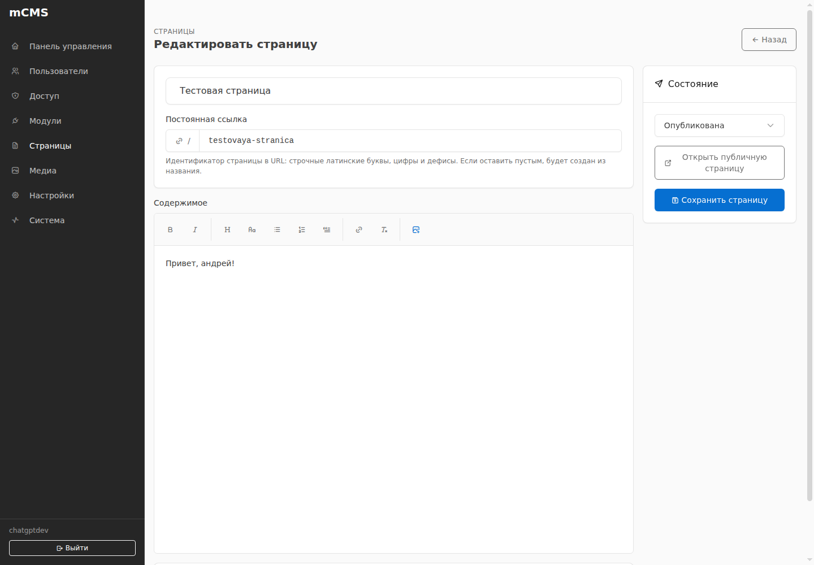

# mCMS

**Modular, self-hosted CMS and e-commerce platform built on CodeIgniter 4.**
Manage websites and shops on your own infrastructure, with optional modules,
installable themes, and no required external service.

**[Project website](https://mirv.top/public_projects/mcms/)** ·
**[Releases & downloads](https://github.com/mirivlad/mcms/releases/latest)** ·
**[Русское руководство](docs/guide/ru/README.md)** ·
**[English guide](docs/guide/en/README.md)**

Pages, news, galleries, SEO and commerce are separate modules. The Core handles
users, permissions, themes, extension lifecycle, updates and backups. Deploy with
**Docker Compose / Portainer** or install the **complete ZIP** on conventional
PHP hosting (PHP 8.2+, supported web server and MySQL/MariaDB).

## Preview

The screenshot shows one of four bundled themes; the administration interface is independent of the public theme.

### Administration

*Example of the administration page editor captured during development;
the current interface has since evolved.*

## Installation / Documentation

- **Русское руководство:** [установка и администрирование](docs/guide/ru/README.md).
- **English guide:** [installation and administration](docs/guide/en/README.md).
- **Standalone hosting:** download the complete shared-hosting ZIP from [Releases](https://github.com/mirivlad/mcms/releases), not GitHub's source ZIP. PHP 8.2+, a supported PHP web server and MySQL/MariaDB are required; private code must be outside DocumentRoot.
- **Docker / Portainer:** Git stack uses `portainer-stack.yml`, with source-built app/web/updater and persistent volumes. For hands-off Core patch updates with published GHCR images, see the [English](docs/guide/en/portainer-auto-updates.md) or [Russian](docs/guide/ru/portainer-auto-updates.md) Portainer setup guide.

## Core stack

- PHP 8.2+ declared for standalone hosting (8.4 in Docker images);
  CI validates each supported PHP minor version;
- CodeIgniter 4.7.4;
- CodeIgniter Shield 1.4.x;
- CodeIgniter Settings 2.4.x;
- MariaDB 11.4;
- nginx + PHP-FPM;
- Bootstrap 5.3.8 for the default public UI;
- Tabler 1.6.1 for the administration shell;
- Docker Compose / Portainer deployment.

## Core responsibilities

- public login, CAPTCHA-protected registration, personal account and authorization
  (see docs/ACCOUNTS.md; email-based password recovery remains planned);
- users, groups and permissions;
- admin dashboard and extension registry;
- module discovery, dependencies, enable/disable/update lifecycle;
- namespaced module migrations;
- persisted Core/module settings;
- stable events/hooks contract;
- storage abstraction;
- browser first-run installation and CLI recovery bootstrap;
- health and diagnostics.

## Modules

News, Galleries, Shop, Orders, Delivery and other domain features are not part
of Core. Media, Pages, Menus, News, Galleries, Feedback, SEO, ProductImages, Catalogue, Stock, Cart, Orders and Delivery are provided as reusable first-party modules.

A module owns its schema, settings, permissions, routes and admin contributions.
Disabling a module preserves its data.

[Analytics](modules/Analytics/README.md) adds built-in traffic tracking with daily
charts, visitors, visits, popular pages, referral sources and device statistics.
It is optional, stores data locally for 90 days and needs no external service.

See [docs/MODULES.md](docs/MODULES.md) and [docs/ARCHITECTURE.md](docs/ARCHITECTURE.md).

## Development status

The current source-tree status is in [docs/STATUS.md](docs/STATUS.md);
released changes are in [CHANGELOG.md](CHANGELOG.md).
Media, Pages, Menus, News, Galleries, Feedback, SEO, ProductImages, Catalogue, Stock, Cart, Orders and Delivery are implemented as reusable modules and covered by
module/integration checks.

Theme API, four first-party themes and Menus ↔ theme-location assignment are implemented.
mCMS Default, [mCMS Signature](themes/mcms-signature/README.md), [mCMS Depth](themes/mcms-depth/README.md) and [mCMS Focus](themes/mcms-focus/README.md) render Home, Pages, News, Galleries, Feedback, Search and Catalogue through logical templates. Depth and Focus include generated local covers and an editable Home in Administration → Themes → Configure: heading, description, Media cover, button and News/Galleries sections, saved independently per theme. A published Home chosen in Pages settings retains priority; choose the built-in Home there to use the theme layout.

The Gallery button in Pages/News editors searches published albums and inserts a shortcode at the cursor. Choose a thumbnail grid, a large banner slider, a horizontal carousel or cards with captions. The same album can use different views on different pages; existing `[gallery id="12"]` shortcodes keep their grid layout. For example: `[gallery id="12" view="slider"]`, `[gallery id="12" view="carousel"]` or `[gallery id="12" view="cards"]`. The album editor also generates a shortcode for the selected view.

Pages and News editors provide private unsaved previews, personal autosave/recovery
and revision history. SEO supports manual metadata and per-content title/description
rules, including keywords from tags. Theme configuration includes per-theme branding,
accent and footer contacts. News supports categories/tag filters; `/search/results`
searches published Pages/News/Catalogue through Core provider contracts.

Catalogue and ProductImages now implement the first commerce stage. Enable
**Catalogue** in Administration → Modules; its separate image module is enabled
as the sole dependency. Products have multiple photos, crop/resize from preserved
originals, main selection, drag-and-drop order, variants and RUB prices. `/shop`
renders the storefront in all four themes. Media and Galleries are independent.
Photo edits save immediately; product/variant fields save with the product form.

Stock provides variant-level on-hand/reserved/available quantities. Cart checks live availability but never reserves stock; Orders creates the reservation only after checkout succeeds. Delivery adds fixed-price delivery and pickup methods whose name/type/price are snapshotted into each order. Orders → Order report provides date/status totals and CSV exports of historical orders and their items, with a separate export permission. See [Orders](modules/Orders/README.md).

Administration → Modules → **Install from ZIP** accepts a module archive,
checks its manifest and dependencies, and shows a preview before adding trusted
code. Enable the added module separately to apply its migrations. Build a package
with `php spark mcms:module:pack modules/Example /tmp/example.zip`; for a repository,
export the required revision first. External modules and their data persist in the common
`modules_data` volume, which must be backed up with the database. Existing
modules cannot be replaced through this installer. See the [package contract](docs/MODULES.md#zip-package-contract).

See [commerce contracts](docs/COMMERCE.md), [Catalogue](modules/Catalogue/README.md)
and [ProductImages](modules/ProductImages/README.md), plus [Stock](modules/Stock/README.md), [Cart](modules/Cart/README.md), [Orders](modules/Orders/README.md) and [Delivery](modules/Delivery/README.md). Back up the shared `modules_data` volume together with the database. No module needs its own volume.

For your own test instance, optional one-time demo content can be enabled with
`MCMS_DEMO_SEED=1` before installation or redeployment. The default is `0`; an
existing database completion marker prevents repeated seeding. Real content is
preserved. See [demo setup](docs/PORTAINER.md#optional-demo-content-for-your-own-test-stack).

### Third-party theme example

[Atelier](examples/themes/mcms-atelier/README.md) is a complete independent
editorial theme, available as a [ready-to-install ZIP](examples/packages/mcms-atelier-1.1.2.zip).
Install it under Administration → Themes → Install theme ZIP; it remains
inactive until explicitly activated. See [the package contract](docs/THEMES.md).

## Extension catalog and lifecycle

Administration → **Extension catalog** browses third-party modules/themes from
this repository's [`catalog/`](catalog/index.json), including Atelier and a small
migration-backed Lifecycle demo. Installation/update downloads lead to the normal
ZIP review and confirmation; installed modules remain disabled. Manual ZIP
upload is still supported.

External packages can be removed while keeping their data, then reinstalled at
the **same version**. Complete removal requires a verified external backup,
explicit confirmation and proven resource ownership. Installed dependents block
both module-removal modes; built-in packages and active themes are protected.
Daily cached checks and `php spark mcms:catalog:refresh` only check for updates.
See [catalog format, PR publication, cleanup contracts and recovery](docs/EXTENSIONS.md).

## File storage

All extensions use two shared Docker volumes: `modules_data` (module packages, uploaded files, generated data and Core files) and `themes_data` (theme packages and theme data). Module-specific volumes are not supported. See [the storage contract](docs/STORAGE.md).

## Automatic updates

Administration → **Updates** configures optional Core/third-party module/theme
auto-updates independently. All switches are **off by default**. A small
unprivileged updater Compose service checks packages periodically; no host cron,
Docker socket mount or external update service is required. Core patch releases
require portainer-release-stack.yml, GitHub Release images and an explicitly
configured HTTPS Portainer API integration. Module migrations and dependent-module
shutdowns remain manual. Read [docs/UPDATES.md](docs/UPDATES.md) before enabling.

## Backups

Create, download and restore full-site ZIP archives from **Administration → Backups**, or schedule `php spark mcms:backup:create --keep=7` from cron. The separately mounted `backup_data` volume holds completed ZIPs, while each archive includes a transaction-consistent MariaDB SQL dump and both CMS data volumes. See [docs/BACKUPS.md](docs/BACKUPS.md).

## Local deployment verification

Run `python3 .github/scripts/verify-deployment.py` to build an isolated test site,
check container recreation and restore its downloaded backup into a second fresh
instance. The command produces a JSON report and cleans up its temporary Docker
stacks without GitHub Actions or manual setup. See [the verification scope](docs/VERIFICATION.md).

See [HTTP header and proxy hardening](docs/SECURITY_HEADERS.md) for deployment security.

## Community and security

See [CONTRIBUTING.md](CONTRIBUTING.md), [AGENTS.md](AGENTS.md) and
[SECURITY.md](SECURITY.md) before submitting code, extensions or reports.

## License

mCMS code, including its first-party modules and themes, is licensed under the
[MIT License](LICENSE).

Third-party dependencies and bundled assets retain their respective licenses.
See [third-party notices](THIRD_PARTY_NOTICES.md) and the license files shipped
with those components. External modules and themes may use their own licenses.

### Standalone / shared-hosting support

Use the full ZIP from GitHub Releases and follow the [Russian](docs/guide/ru/installation.md) or [English](docs/guide/en/installation.md) instructions. Composer dependencies, CSS/JS and manuals are bundled. An embedded installer sets up a fresh MySQL database, and private Core data remains outside `public_html`. See the [hosting requirements and limits](docs/SHARED_HOSTING.md), especially PHP quotas and recovery compatibility.
